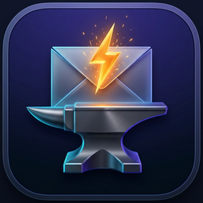

#  Mail Forge

Stateless, multi-account Gmail triage client built with **Angular 20** and **Angular Material**. Instead of downloading gigabytes of duplicate IMAP folders like Thunderbird, Mail Forge queries the **Gmail REST API** directly and routes messages into **purpose-built Category UIs**:

- **📦 Orders & Package Tracker (`orders`)**: 4-step delivery progress bar (`Ordered` → `Shipped` → `Out for Delivery` → `Delivered`), carrier badges (`UPS`, `FedEx`, `USPS`, `Amazon`, `DHL`), tracking number copy, `schema.org/Order` JSON-LD parsing, and 1-click *Archive Delivered*.
- **🔔 Notifications Rollup (`notifications`)**: Groups GitHub PRs, Issues, and CI/CD alerts by `owner/repo` inside collapsible `MatExpansionPanel`s with 1-click *Archive Repo* batch actions.
- **📰 Newsletter Reading Deck (`newsletters`)**: Split-pane magazine reader with extracted Quick Takeaways, read-time estimates, and 1-click *Archive Issue* or *Forward Issue* via the Gmail API.
- **🔑 2FA & Verification Codes (`two_factor`)**: Global floating quick-copy banner at the top of the app + OTP vault with 1-click *Copy Code & Archive*.
- **💳 Bills & Statements Ledger (`bills`)**: Statement balances, due dates, minimum payments, account last-4 (`••4821`), and `Autopay Scheduled` vs. `Due Soon` status badges.
- **📅 Events & Invitations (`events`)**: Calendar invite parser (`When`, `Where`, Google Meet / Luma links) with quick *Accept / Maybe / Decline & Archive* RSVP buttons.
- **🧩 Custom Category Rules**: Add new keyword/regex categories via the UI (`+ Add Category Rule`) or register full custom UI views in code (see [AGENTS.md](./AGENTS.md)).

---

## 1. Local Development & Running

```bash
# Ensure Node 20+ is on your PATH
export PATH="$HOME/.nvm/versions/node/v20.20.2/bin:$PATH"

cd /usr/local/google/home/fleker/dev/mail-forge

# Install dependencies (if needed)
npm install --legacy-peer-deps

# Start the dev server on http://localhost:4205
npm start

# Run headless Karma unit tests
npm test

# Build production bundle into dist/mail-forge
npm run build
```

Out of the box, Mail Forge boots with a **3-account Demo Seed** (`nick.personal@gmail.com`, `fleker.dev@gmail.com`, `nick.shopping@gmail.com`) so you can test every category view immediately. Click the **Reset Demo Data** (`restart_alt`) icon in the top-right toolbar at any time to restore the sample dataset.

---

## 2. How to Set Up Google Cloud & Add Multiple Gmail Accounts (Zero Re-Login)

To connect your real `@gmail.com` addresses **without** having to re-authenticate every 7 days, create a personal Google Cloud OAuth 2.0 Client and set its publishing status to **In Production**.

### Step 1: Enable the Gmail API
1. Open the [Google Cloud Console](https://console.cloud.google.com/).
2. Create a new project (e.g., `mail-forge-personal`) or select an existing personal project.
3. Navigate to **APIs & Services → Library**, search for **Gmail API**, and click **Enable**.

### Step 2: Configure the OAuth Consent Screen (Prevent 7-Day Token Expiry)
1. Go to **APIs & Services → OAuth consent screen** (or **Google Auth Platform → Audience**).
2. Choose **External** user type and fill in the required fields:
   - **App name**: `Mail Forge`
   - **User support email** & **Developer contact email**: your primary Gmail address.
3. Under **Data Access / Scopes**, add:
   - `https://www.googleapis.com/auth/gmail.modify`
   - `https://www.googleapis.com/auth/userinfo.email`
4. **CRITICAL — Prevent Weekly Re-Logins**:
   - In **OAuth consent screen / Audience**, click **Publish App** to move the Publishing status from `Testing` to **In Production**.
   - *Why?* Google forcibly expires OAuth refresh tokens after **7 days** when an app is in `Testing` mode. Moving to **In Production** removes the 7-day cap immediately.
   - You do **not** need to submit for paid CASA verification for your own personal accounts (Google allows up to 100 personal users via the unverified warning screen).

### Step 3: Create OAuth 2.0 Client Credentials
1. Go to **APIs & Services → Credentials** and click **+ Create Credentials → OAuth client ID**.
2. Select **Application type**: **Web application**.
3. Under **Authorized JavaScript origins**, add:
   - `http://localhost:4205` (for local development)
   - `https://fleker.github.io` (if hosted on GitHub Pages)
4. Under **Authorized redirect URIs**, add:
   - `http://localhost:4205/` (for local development)
   - `https://fleker.github.io/email-forge/` (for GitHub Pages static hosting)
5. Click **Create** and copy your **Client ID** (`...apps.googleusercontent.com`) and **Client Secret** (`GOCSPX-...`).

### Step 4: Connect Your Gmail Accounts in Mail Forge
1. Start Mail Forge (`npm start`) and click **Accounts / OAuth** in the top toolbar.
2. Paste your **GCP OAuth Client ID** and **GCP OAuth Client Secret**, then click **Save Credentials**.
3. *(Optional)* Enter the email address you want to connect in **Account Hint** (e.g., `my.first.account@gmail.com`) so Google pre-selects that account.
4. Click **Authorize & Add Gmail Account**:
   - In the Google login prompt, choose the Gmail account you want to add.
   - When Google displays *"Google hasn't verified this app"*, click **Advanced → Go to Mail Forge (unsafe)** and grant `gmail.modify` access.
5. Mail Forge exchanges the authorization code (`access_type=offline&prompt=consent`) for a permanent **`refresh_token`**, saves the account in `localStorage` (`mail_forge_accounts`), and immediately syncs its inbox.
6. **Repeat Step 4** for each additional Gmail account you want to add.
   - Each account gets its own color-coded switcher pill in the top toolbar, and all accounts merge into the **All Accounts** unified stream and category views.
   - Whenever an `access_token` nears its 1-hour expiry, `GmailApiService.ensureValidAccessToken()` silently mints a fresh token using the stored `refresh_token`.
   - *(Optional)* Once your real accounts are connected, you can remove the 3 demo seed accounts using the trash icon inside the **Accounts / OAuth** modal.
